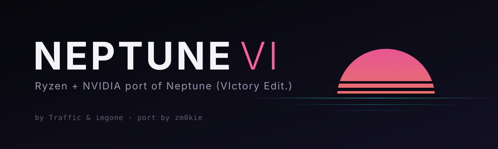

<p align="center">
  
</p>

<p align="center">
  
  
  
  
</p>

<p align="center">
  Runs the Xbox Series build of <b>GTA VI</b> on a Windows PC.<br>
  A port of <b>Neptune (VIctory Edit.)</b> by <b>Traffic</b> &amp; <b>imgone</b> for AMD Ryzen + NVIDIA.
</p>

<br>

## ◆ Why this port

Upstream froze the GPU right before the first gameplay scene on a Ryzen 7 9800X3D with an RTX 5070 Ti. The cause: the game's indirect draw arguments ran unchecked, and some of them hold garbage.

This port checks every such record on the CPU first. Sane records run as fast as before, broken ones go through the safe path. **The game now gets into gameplay.**

<br>

## ◆ Quick start

> [!IMPORTANT]
> No game files are included. You need your own copy of the game.

```powershell
# first launch: translates the shaders (~7 min), then starts the game
.\play-zm.ps1 -Game 'D:\GTA6\game_scarlett_master.exe' -SeriesX -Ram32 -Warm

# every launch after that
.\play-zm.ps1 -Game 'D:\GTA6\game_scarlett_master.exe' -SeriesX -Ram32
```

| Switch | |
|:--|:--|
| `-SeriesX` | 4K Series X path |
| `-Ram32` | profile for 32 GB RAM |
| `-Stats -Tag x` | log + memory curve to files |
| `-Dred` | names the shader when the GPU hangs |

**Controls** · F9 mouse look · WASD move · Enter / Backspace / X / Y as A / B / X / Y · F10 overlay · F12 screenshot

<br>

## ◆ Build

```powershell
cargo build --release -p victory
```

Needs Visual Studio Build Tools (MSVC + Windows SDK) and [rustup](https://rustup.rs). Put `target\release\victory.exe` next to `tools\play-zm.ps1`.

<br>

## ◆ Known limits

- Ray-traced light is not running yet. An ambient pass stands in, so some rooms and water look off.
- Frame rate dips while the world streams in.
- Tested on one PC: Ryzen 7 9800X3D · RTX 5070 Ti 16 GB · 32 GB RAM.

<br>

## ◆ Credits

**Traffic** &amp; **imgone** for Neptune, the base of this port.
Built on Marvisak/VIctory, myokex, fxceless, soldsawn, Belobug, ZSlayerHQ, JoshuuDev and more, see [`docs/NEPTUNE-README.txt`](docs/NEPTUNE-README.txt).
Port by **zm0kie**.

<br>

<p align="center">
  <sub>GPL-3.0-or-later · not affiliated with Rockstar Games, Take-Two Interactive or Microsoft</sub>
</p>
